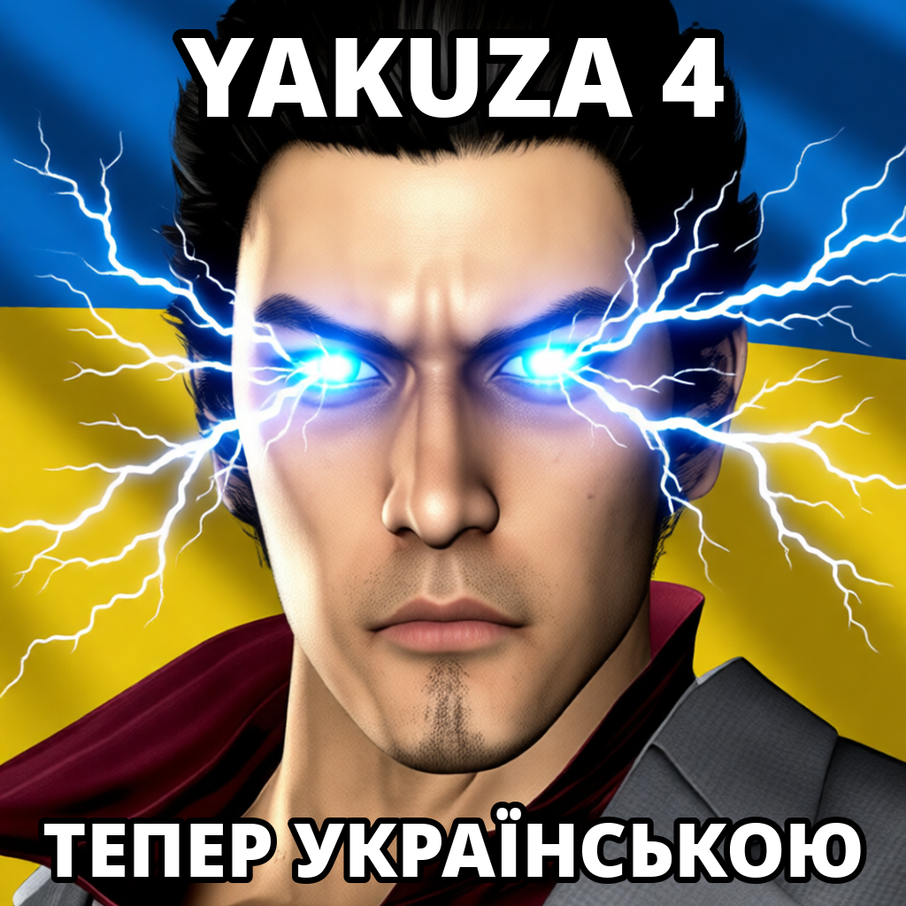

# Українізатор Yakuza 4 Remastered (бета)

Український переклад гри **Yakuza 4 Remastered** (Steam, ПК і Steam Deck).

> **Чесно:** переклад виконано штучним інтелектом (Claude) з автоматичною перевіркою й коректурою.
> Це не людський переклад, а бета-версія. Можливі неточності, дивні фрази й рядки, що вилазять за рамки.
> Гру з перекладом ще ніхто не пройшов повністю — якщо щось вилітає чи виглядає криво, напишіть у
> [Issues](https://github.com/PiGYk/yakuza4-ukr/issues), бажано зі знімком екрана.

## Що перекладено
- субтитри всіх відеосцен (3 568 рядків);
- усі діалоги й побічні історії (68 125 рядків);
- меню, налаштування, підказки, предмети, вміння, крамниці, пошта, імена хостес, репліки перехожих,
  біографії персонажів (18 316 рядків);
- шрифти: додано українські літери (і ї є ґ), лапки «» і тире —;
- 161 пензлевий напис: титри розділів, представлення суперників перед боєм, цілі місій, погоні,
  турніри колізею, заставка «Справжні якудза грають геймпадом». Літери намальовано за точним шаблоном,
  мазок пензля — ШІ (Qwen-Image-Edit);
- написи інтерфейсу на картинках (156 текстур): меню паузи, підказки дій, кнопки, крамниці, колізей,
  хостес-клуб, тренування бійців;
- міні-ігри: меню й екрани керування, таблиці казино, маджонг, покер, дартс, гольф, репліки чьо-хан,
  рядки й титульні картки пісень у караоке;
- правила міні-ігор (136 сторінок) і попередження на старті гри. Де текст лежав на малюнку, англійське
  стерто ШІ (Qwen-Image-Edit), а українські літери набрано звичайним шрифтом.

Імена — за українським стандартом передачі японських (система Коваленка): Кадзума Кірю, Сюн Акіяма,
Тайґа Саедзіма, Масайосі Танімура, Камуротьо.

## Ще не перекладено
- слова, які гра складає з окремих літер на ходу: LEVEL UP, STRIKE/SPARE у боулінгу, CONGRATULATIONS
  у кран-машині;
- логотипи (OVERKILL, Point Card) і рукописні примітки на трьох ескізах прийомів;
- дрібні вертикальні підписи в дартсі й підписи на знімках екрана в правилах дартсу;
- шрифт таблиці рекордів (у ньому немає місця під кирилицю).

## Встановлення
Потрібна **Steam-версія** Yakuza 4 Remastered (збірка гри 6407475) і ~1 ГБ вільного місця.
Завантажте архів з [останнього релізу](https://github.com/PiGYk/yakuza4-ukr/releases/latest) і розпакуйте.
Архів не містить файлів гри — лише латки (різницю між оригіналом і перекладом), які застосовуються
до ВАШИХ файлів. Перед встановленням закрийте гру.

**Steam Deck / Linux:** режим робочого столу → відкрийте теку з архівом у Dolphin → правою кнопкою
«Відкрити термінал» → `bash vstanovyty.sh`. Видалити: `bash vstanovyty.sh --povernuty`.

**Windows:** двічі клацніть `vstanovyty.bat` (сам знайде гру в Steam). Видалити: `povernuty.bat`.

Встановлювач перевіряє кожен файл за контрольною сумою до і після змін; якщо версія гри інша — нічого
не змінює. «Перевірка цілісності файлів» у Steam або оновлення гри повертають англійську — тоді просто
встановіть ще раз. Детально — у `README.txt` всередині архіву.

## Автори
Скіф для Олега Дергачова (PiGyk). Yakuza 4 Remastered — © SEGA. Це неофіційний фанатський переклад,
не пов'язаний із SEGA чи RGG Studio.
